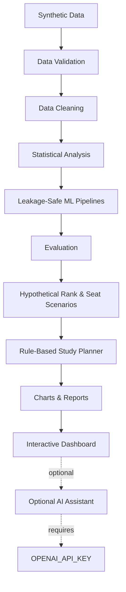

# CEE SAATHI AI — Medical Entrance Intelligence & Prediction Platform

<div align="center">


### *Educational Machine Learning · Student Performance Analytics · Predictive Intelligence*

Created by **Nirmal Saud** · [MrNiriTech](https://www.youtube.com/@MrNiriteach) · [GOHIX](https://github.com/mrniriteachai-eng)

<br>

<a href="https://youtu.be/lovsuJKoJso" target="_blank">
    
</a>

</div>

---

<!-- ===================== BADGES ===================== -->

<div align="center">


</div>

---

<!-- ===================== YOUTUBE VIDEO ===================== -->

## 🎥 Complete Project Demonstration

<div align="center">

<a href="https://youtu.be/lovsuJKoJso" target="_blank">
    
</a>

<br><br>

<a href="https://youtu.be/lovsuJKoJso" target="_blank">
    
</a>

</div>

---

<!-- ===================== RESPONSIBLE AI DISCLAIMER ===================== -->

## ⚠️ Important — Demo Data & Responsible AI Disclaimer

> **This project is an educational demonstration. It is NOT an official CEE prediction service, admission guarantee, or a source of verified examination information.**

<div align="center">

<table style="width: 90%;">
<tr>
<td style="padding: 14px; background: rgba(255,165,0,0.1); border-radius: 10px; border-left: 4px solid #FFA500;">
<strong>Synthetic Data Only</strong><br>
All 1,200 student records are synthetic. Every generated row is labelled <code>DEMO DATA</code>. No real Nepalese student records are used.
</td>
<td style="padding: 14px; background: rgba(255,165,0,0.1); border-radius: 10px; border-left: 4px solid #FFA500;">
<strong>Configurable Marking Scheme</strong><br>
The marking scheme is user-configurable via <code>Config.subjects</code>. It is <em>not</em> the official CEE marking scheme.
</td>
</tr>
<tr>
<td style="padding: 14px; background: rgba(255,165,0,0.1); border-radius: 10px; border-left: 4px solid #FFA500;">
<strong>No Official Data Access</strong><br>
This project does not access official CEE results, real rankings, actual seat availability, scholarships, reservation rules, or official cutoffs.
</td>
<td style="padding: 14px; background: rgba(255,165,0,0.1); border-radius: 10px; border-left: 4px solid #FFA500;">
<strong>Not Validated for Real Prediction</strong><br>
Models trained on synthetic labels are <strong>not</strong> validated predictors of real CEE outcomes. Correlation does not imply causation.
</td>
</tr>
</table>

</div>

### Three Distinct Concepts — Do Not Confuse Them

| Concept | What It Is | What This Project Produces |
|---------|-----------|----------------------------|
| **A. Threshold Scenario** | A configurable mathematical scenario based on user-entered demo assumptions | ✅ Yes |
| **B. Model Probability** | A probability estimated by a model trained on synthetic labels | ✅ Yes |
| **C. Official Result** | An official examination result published by the relevant authority | ❌ No |

**This project produces A and B only. It does not produce or verify C.**

- **Rank** in this project means percentile or approximate position *inside the synthetic demo cohort only* — not an official Nepal CEE rank.
- **Seat counts and cutoff values** are user-entered hypothetical scenario values — not official data.
- **Models trained on synthetic labels** are not validated predictors of real CEE outcomes.

---

<!-- ===================== TABLE OF CONTENTS ===================== -->

## 📚 Table of Contents

| Serial | Section | Link |
|--------|---------|------|
| 01 | Project Overview | [Jump](#project-overview) |
| 02 | Core Features | [Jump](#core-features) |
| 03 | Project Architecture | [Jump](#project-architecture) |
| 04 | Data Leakage Prevention | [Jump](#data-leakage-prevention) |
| 05 | Machine Learning Models | [Jump](#machine-learning-models) |
| 06 | Interactive Dashboard | [Jump](#interactive-dashboard) |
| 07 | Quick Start | [Jump](#quick-start) |
| 08 | Output Structure | [Jump](#output-structure) |
| 09 | Testing & Verification | [Jump](#testing--verification) |
| 10 | Responsible Use & Real-Data Transition | [Jump](#responsible-use--real-data-transition) |
| 11 | Future Improvements | [Jump](#future-improvements) |
| 12 | License & Educational Use | [Jump](#license--educational-use) |
| 13 | Author | [Jump](#author) |

---

<!-- ===================== PROJECT OVERVIEW ===================== -->

## Project Overview

<div style="background: rgba(26,26,74,0.3); border-radius: 16px; padding: 28px; border: 1px solid rgba(107,33,181,0.25);">

**CEE SAATHI AI** is an educational Jupyter-based analytics and Machine Learning project designed around Nepal's medical entrance preparation ecosystem.

It demonstrates how the following can be combined into one educational intelligence platform:

- **Mock-test performance analytics**
- **Statistical analysis** (Spearman correlation, group comparisons, trend analysis)
- **Data cleaning and validation** (schema validation, IQR outlier detection, missing-value handling)
- **Predictive modelling** (Dummy Classifier, Logistic Regression, Random Forest)
- **Hypothetical threshold scenarios** (configurable pass/fail zones)
- **Cohort-based ranking** (percentile calculation inside demo cohort only)
- **Seat-scenario calculations** (user-entered hypothetical values)
- **Rule-based study planning** (transparent scheduling, reminders, progress tracking)

The project helps demonstrate how students can explore mock-test performance, understand preparation patterns, compare hypothetical scenarios, review analytics, and organize study plans.

> **It is an educational demonstration — not an official CEE result prediction service.**

### Why This Project Exists

Most medical entrance students in Nepal prepare in isolation, without access to structured analytics about their own performance. This project explores how accessible, transparent data analysis and ML could support preparation — while demonstrating the complete ML pipeline in a safe, synthetic-data environment.

</div>

---

<!-- ===================== CORE FEATURES ===================== -->

## Core Features

### A. Configuration & Project Setup

| Feature | Description |
|---------|-------------|
| Dependency checks | Verifies required packages are installed |
| `Config` dataclass | Central configuration for subject settings, thresholds, seeds |
| Reproducible random seeds | Ensures deterministic synthetic-data generation |
| Logging | Structured execution logging |
| Pathlib-based directories | Cross-platform output folder management |

### B. Synthetic Student Dataset

| Feature | Description |
|---------|-------------|
| 1,200 synthetic students | Configurable cohort size |
| Mock-test history | Multiple attempts per student |
| Raw-messy dataset | Separate copy with intentional data issues |
| Missing values | Deliberately introduced |
| Duplicate records | Deliberately introduced |
| Impossible values | Deliberately introduced |
| Outliers | Deliberately introduced |
| Synthetic outcome generation | Based on a hidden simulated final score |

> **Why synthetic data?** It makes the project suitable for safe educational experimentation without exposing any real student's information.

### C. Data Cleaning & Validation

- Schema validation
- Duplicate removal
- Range checks
- IQR-based outlier flags
- Data-quality reporting
- Missing-value handling

### D. Pass/Fail & Threshold Scenario Analysis

- Configurable demo threshold
- Performance bands
- Below-threshold zone
- Near-threshold zone
- Above-threshold zone
- Sensitivity analysis

> Changing the threshold shifts which students fall into each hypothetical zone. This is a mathematical scenario, not an official pass/fail result.

### E. Statistical Analysis

- Spearman correlation (rank-based, non-parametric)
- Group comparisons across performance bands
- Trend analysis over mock attempts
- Preparation-pattern analysis
- Statistical summaries

### F. Machine Learning Models

| Model | Role |
|-------|------|
| **Dummy Classifier** | Baseline — predicts the majority class |
| **Logistic Regression** | Linear model with calibrated probabilities |
| **Random Forest** | Non-linear ensemble classifier |

All models are implemented using:
- Scikit-learn **pipelines** (imputation + scaling + model in one object)
- **Cross-validation** on training data
- **Held-out evaluation** on a test set
- **Calibration table** — compares predicted probability bins to observed rates
- **Permutation feature importance**
- **Error analysis**
- **Leakage guard** (see next section)
- **Single-feature AUC scan** — checks for suspicious single-feature predictive power
- **Refusal to train** when insufficient data is available

> **No accuracy, precision, recall, F1, or AUC values are invented in this README.** Any metrics reported must come from actual reproducible output. Run the notebook to see current values.

### G. Data Leakage Prevention

See the dedicated [Data Leakage Prevention](#data-leakage-prevention) section below.

### H. Hypothetical Rank Calculator

- Percentile calculation within the demo cohort
- Approximate position inside the synthetic cohort
- Cohort-based interpretation

> This is **not** an official Nepal CEE rank. It is a percentile inside 1,200 synthetic students.

### I. Seat Scenario Calculator

- User-entered scenario values
- Input validation
- Source and `last_verified` requirements for records
- Hypothetical seat/cutoff scenarios

> The application does **not** know actual seat availability, official cutoffs, scholarships, or reservation rules. Users enter these values themselves as hypothetical assumptions.

### J. Rule-Based Study Planner

- Transparent study scheduling
- Reminders
- Mock-test scheduling
- Progress tracking
- Adjustment based on saved attempts

> This is a **rule-based planner**, not an autonomous AI tutor.

### K. Data Visualization

- **15 Matplotlib charts**
- **5 interactive Plotly versions**
- Automatic fallback to Matplotlib when interactive plotting is unavailable
- Performance and preparation analytics

### L. Reports & Exports

- Individual student report
- Cohort summary
- CSV export
- JSON export
- HTML export
- Structured output directory

### M. Interactive Dashboard

Documented in detail in the [Interactive Dashboard](#interactive-dashboard) section.

### N. Optional AI Assistant

| Feature | Detail |
|---------|--------|
| Optional OpenAI integration | Only activated when `OPENAI_API_KEY` is set |
| Environment variable | `OPENAI_API_KEY` |
| Optional model override | `OPENAI_MODEL` |
| Anonymised aggregate information | No student-identifying data sent |
| Anti-hallucination system prompt | Constrains assistant responses |
| Missing-key handling | The project works fine without a key |
| Missing-package handling | Graceful degradation |
| API error handling | Failures do not break the main workflow |

> The main project works **without** an API key. Never hard-code secrets.

### O. Unit Tests

- **37 unittest tests**
- Executed inside the notebook
- Reports actual test status
- Clearly distinguishes what is and is not tested

---

<!-- ===================== PROJECT ARCHITECTURE ===================== -->

## Project Architecture



The optional AI assistant is a **separate optional component**. The main workflow does not require it.

---

<!-- ===================== DATA LEAKAGE PREVENTION ===================== -->

## Data Leakage Prevention

Data leakage is one of the most common reasons a Machine Learning project produces misleading results. This project takes explicit measures to prevent it.

### The Leakage-Safe Design

| Mechanism | What It Does |
|-----------|--------------|
| **`demo_outcome`** | Generated from a hidden simulated final score |
| **Hidden final score excluded** | The hidden simulated final score is never in the feature table |
| **`FORBIDDEN_FEATURES`** | Explicit list containing `total_score`, `total_pct`, `latest_mock_score`, IDs, dates, and the label itself |
| **Error on forbidden use** | Requests to use forbidden features raise an error |
| **Pipeline-fitted preprocessing** | Imputation and scaling are fitted *inside* pipelines and training folds — never on the test set |
| **Out-of-fold probabilities** | Cohort probabilities are generated out-of-fold |

### Why This Matters

At prediction time in a real scenario, a student does **not** yet have their final score, their final percentage, or their latest mock-test result for the exam they are preparing for. If a model is trained using those values, it may "learn" information that would not legitimately be available when a prediction is actually needed — producing unrealistically good results that collapse in real use.

> **Important:** These safeguards improve the *educational quality* of the experiment. They do **not** make synthetic-data results valid predictors of real CEE outcomes.

---

<!-- ===================== MACHINE LEARNING MODELS ===================== -->

## Machine Learning Models

All three models are trained inside scikit-learn pipelines so that preprocessing is applied consistently during both training and evaluation.

| Aspect | Implementation |
|--------|----------------|
| Baseline | `DummyClassifier` — majority class |
| Linear model | `LogisticRegression` inside a pipeline |
| Non-linear model | `RandomForestClassifier` inside a pipeline |
| Evaluation | Held-out test set + cross-validation |
| Calibration | Calibration table by probability bin |
| Feature importance | Permutation importance |
| Leakage check | Forbidden-feature error + single-feature AUC scan |
| Error handling | Graceful refusal when data is insufficient |

> **No numeric metrics are reported here.** Any metrics you see must be reproduced from the notebook. Run it to inspect the actual values.

---

<!-- ===================== INTERACTIVE DASHBOARD ===================== -->

## Interactive Dashboard

**File:** `reports/cee_saathi_dashboard.html`

The dashboard is a **standalone interactive HTML file**. It is **not** a hosted multi-user web application.

### Verified Features

| Feature | Description |
|---------|-------------|
| KPI overview | Summary statistics at the top |
| Slider-based scenario interaction | Adjust threshold and see the effect |
| 10 charts | Canvas-rendered charts |
| Heatmap | Preparation-pattern visualization |
| Model section | Model summary panel |
| Load-CSV button | Load a different dataset |
| Light/dark mode | User-selectable theme |

> The dashboard JavaScript was tested against a **stubbed DOM**. All 10 canvas charts were built, and slider/reset interactions were tested. The dashboard was **not** opened and fully tested in a real browser — treat this as a known limitation.

---

<!-- ===================== QUICK START ===================== -->

## Quick Start

### 1. Clone and Enter the Project

```bash
git clone https://github.com/mrniriteachai-eng/cee-saathi-ai
cd cee-saathi-ai
```

> Adjust the repository URL if your actual repository URL differs.

### 2. Create a Virtual Environment

```bash
python -m venv .venv

# Linux / macOS
source .venv/bin/activate

# Windows
.venv\Scripts\activate
```

### 3. Install Dependencies

```bash
pip install -r requirements.txt
```

### 4. Run the Notebook

```bash
jupyter lab CEE_Saathi_AI_FINAL.ipynb
```

Inside Jupyter, select:

**Run → Restart Kernel and Run All Cells**

### 5. Headless Alternative (if `CEE_Saathi_AI_FINAL.py` exists)

```bash
python CEE_Saathi_AI_FINAL.py
```

> Only use this command if that exact script exists in the repository. Confirm before running.

### Expected Output Directory

```text
cee_saathi_output/
├── data/
├── figures/
└── reports/
```

**Estimated runtime:** approximately one minute on a typical laptop. This is an estimate, not a guarantee.

---

<!-- ===================== OUTPUT STRUCTURE ===================== -->

## Output Structure

```text
cee_saathi_output/
├── data/         # Processed datasets and exports (CSV/JSON)
├── figures/      # Matplotlib and Plotly chart outputs
└── reports/      # HTML reports and dashboard
    └── cee_saathi_dashboard.html
```

| Folder | Contents |
|--------|----------|
| `data/` | Cleaned data, exported CSVs, JSON exports |
| `figures/` | Chart images and Plotly HTML output |
| `reports/` | Individual reports, cohort summary, dashboard |

---

<!-- ===================== TESTING & VERIFICATION ===================== -->

## Testing & Verification

The project was executed top-to-bottom in a **fresh Jupyter kernel** with the following environment:

| Component | Version |
|-----------|---------|
| Python | 3.12 |
| pandas | 3.0.2 |
| scikit-learn | 1.8.0 |
| matplotlib | 3.10 |
| plotly | 7.1 |
| scipy | 1.17 |

**Reported result:**
- No notebook cell errors
- **37/37 unit tests passed**

**Dashboard verification:**
- JavaScript tested against a **stubbed DOM**
- All 10 canvas charts built successfully
- Slider and reset interactions tested

### Known Limitations

> Transparency matters. This project was **not** tested under every possible condition.

- ❌ The dashboard was **not** opened and fully tested in a real browser.
- ❌ A live OpenAI API call was **not** tested (no API key available).
- ❌ Other dependency versions were **not** verified.
- ❌ Windows and macOS were **not** tested.

---

<!-- ===================== RESPONSIBLE USE & REAL-DATA TRANSITION ===================== -->

## Responsible Use & Real-Data Transition

This project uses synthetic data **only**. If it were later adapted to verified historical data, the following steps would be necessary:

1. **Preserve existing column names** where appropriate.
2. **Validate the schema**.
3. **Run `validate_schema` and `clean_dataset`**.
4. **Replace `demo_outcome`** with a verified historical outcome.
5. **Validate on a later cohort** (temporal holdout).
6. **Document data sources and assumptions**.
7. **Review privacy, consent, and data protection requirements** before using real student records.

### Why No Database Integration?

SQLite storage was intentionally left out. A local notebook database is **not** a secure multi-user platform. Adding a database without proper authentication, authorization, and encryption would give a false sense of security.

### Official Information

> **Always check official examination rules, dates, seat availability, scholarships, cutoffs, and results from official sources.** This project does not provide verified official data.

---

<!-- ===================== FUTURE IMPROVEMENTS ===================== -->

## Future Improvements

These are **planned** directions, not existing features.

| Area | Planned Improvement |
|------|---------------------|
| Data | Secure database integration (with proper auth) |
| Tracking | Improved student progress tracking across cohorts |
| Analytics | Additional statistical analysis methods |
| ML | More validated model experiments on real historical data |
| Accessibility | Better dashboard accessibility |
| Exports | More export formats |
| Data sources | Verified historical dataset support |
| Integration | Responsible integration with official public information |
| Quality | Better documentation and automated testing |

> **None of these features exist yet.** They represent an honest roadmap.

---

<!-- ===================== LICENSE & EDUCATIONAL USE ===================== -->

## License & Educational Use

This project is an **educational demonstration**.

> **It must not be treated as:**
> - An official CEE prediction system
> - An admission guarantee
> - A scholarship predictor
> - A source of verified examination information

### License Status

If a `LICENSE` file exists in this repository, the license in that file governs this project. If no `LICENSE` file is present, the licensing status has not been formally decided and must be confirmed before redistribution or commercial use.

**Do not assume open-source license terms unless a `LICENSE` file explicitly states them.**

---

<!-- ===================== AUTHOR ===================== -->

## Author

<div style="background: rgba(26,26,74,0.3); border-radius: 16px; padding: 24px; border: 1px solid rgba(107,33,181,0.2);">

**Nirmal Saud**  
Founder · AI-focused learner · Tech content creator from Nepal

**Focus Areas:** Artificial Intelligence · Machine Learning · Deep Learning · Python · Technology Education

<div align="center">

<table style="width: 80%;">
<tr>
<td style="padding: 10px; text-align: center;">
    <a href="https://nirmalsaud.com.np/" target="_blank"></a>
</td>
<td style="padding: 10px; text-align: center;">
    <a href="https://github.com/mrniriteachai-eng" target="_blank"></a>
</td>
</tr>
<tr>
<td style="padding: 10px; text-align: center;">
    <a href="https://www.youtube.com/@MrNiriteach" target="_blank"></a>
</td>
<td style="padding: 10px; text-align: center;">
    <a href="https://www.linkedin.com/in/nirmal-saud-a850193a0/" target="_blank"></a>
</td>
</tr>
</table>

</div>

</div>

---

<!-- ===================== FOOTER ===================== -->

<div align="center">


<br>

<em>"Learn the fundamentals. Build real projects. Understand the mathematics. Keep experimenting. Turn knowledge into practical skills."</em>

<br><br>

**CEE SAATHI AI** — Educational Machine Learning Demonstration

Created by **Nirmal Saud** · [MrNiriTeach](https://www.youtube.com/@MrNiriteach) · [GOHIX](https://github.com/mrniriteachai-eng)

</div>
